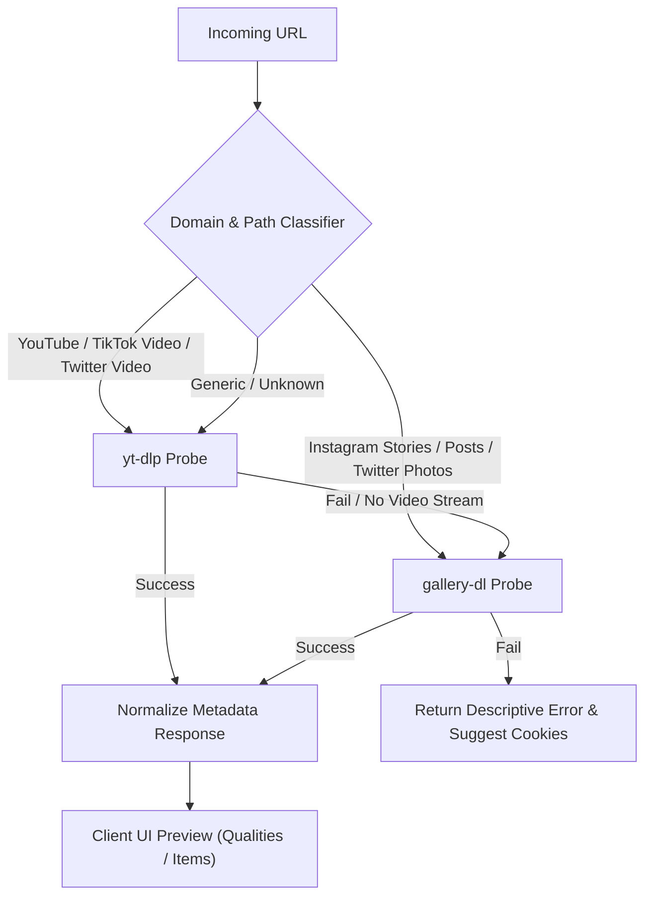

# AGENTS.md — All-in-One Media Downloader Web App

This document defines the architecture, technical standards, project conventions, and operational workflows for AI agents and human developers building and maintaining the **All-in-One Media Downloader**.

---

## 1. Project Overview & Vision

An open-source, self-hosted web application capable of extracting and downloading rich media (videos, audio, multi-image carousels, and stories) across major platforms—including **YouTube, Instagram (posts, reels, stories), Twitter/X (videos, images), TikTok**, and other supported sites.

The solution leverages **`yt-dlp`** and **`gallery-dl`** orchestrating through a unified API, accompanied by **`ffmpeg`** for rich post-processing (format remuxing, audio conversion, and metadata embedding).

### Core Principles
- **Fast & Responsive**: Real-time progress updates via Server-Sent Events (SSE).
- **Two-Step Inspection**: Rich media inspection/preview before downloading (allowing selection of qualities, audio-only, or individual story/carousel items).
- **Smart Routing & Fallback**: Automated domain- and content-aware dispatch between `yt-dlp` and `gallery-dl`.
- **Resilient Authentication**: Server-side cookie storage and a UI Settings panel to easily supply cookies for authenticated/rate-limited sessions (crucial for Instagram stories and Twitter/X).
- **Zero-Clutter Storage**: Dual delivery (individual downloads or bundled ZIPs) with automated background TTL garbage collection.
- **Single-Container & Easy Local Dev**: Single unified container deployment and a single-command launcher script for local development.

---

## 2. Technology Stack & Runtime Tools

### Runtime Environment
- **Python Runtime & Package Manager**: `uv` (>= 0.4.x)
- **JavaScript/TypeScript Runtime & Package Manager**: `bun` (>= 1.1.x)
- **System Utilities**: `pyffmpeg` (>= 2.5.2 via backend uv dependencies, with optional system `ffmpeg` fallback), `yt-dlp` (latest via Python/uv), `gallery-dl` (latest via Python/uv)

### Backend Architecture
- **Framework**: **FastAPI** (Python 3.12+) with **Uvicorn**
- **Concurrency & Async**: AsyncIO task execution for metadata extraction and download jobs
- **Real-Time Streaming**: Server-Sent Events (SSE) via `sse-starlette`
- **Data Validation**: Pydantic v2 schemas
- **Archive Generation**: Python `zipfile` streaming/compression
- **Dependency Management**: `pyproject.toml` managed strictly with `uv`

### Frontend Architecture
- **Framework**: **Vite + React (TypeScript)** managed strictly with `bun`
- **Styling**: **Tailwind CSS** with modern UI components (shadcn/ui or Radix UI primitives)
- **Icons**: `lucide-react`
- **State & Data Fetching**: TanStack Query (React Query) for API communication + SSE event listeners

---

## 3. Repository Structure

```
.
├── AGENTS.md                  # This file
├── backend/                       # Python FastAPI Backend (managed via uv)
│   ├── app/
│   │   ├── __init__.py
│   │   ├── main.py                # FastAPI entrypoint & static mounting
│   │   ├── config.py              # App configuration, env variables, paths
│   │   ├── models/                # Pydantic schemas (requests, responses, metadata)
│   │   │   ├── inspect.py
│   │   │   ├── download.py
│   │   │   └── cookies.py
│   │   ├── routers/               # API route handlers
│   │   │   ├── inspect.py         # POST /api/inspect
│   │   │   ├── download.py        # POST /api/download, GET /api/files/{id}
│   │   │   ├── progress.py        # GET /api/progress/{task_id} (SSE)
│   │   │   └── settings.py        # Cookie & system status endpoints
│   │   └── services/              # Core business & extraction logic
│   │       ├── router.py          # Domain & content-aware extractor dispatcher
│   │       ├── ytdlp_service.py   # yt-dlp wrapper & progress parser
│   │       ├── gallerydl_service.py # gallery-dl wrapper & parser
│   │       ├── ffmpeg_service.py  # Audio extraction, remuxing, metadata embedding
│   │       ├── cookie_manager.py  # Cookie validation & runtime reloading
│   │       ├── zip_service.py     # Multi-item bundling into .zip
│   │       └── cleaner.py         # Background TTL storage cleanup
│   ├── tests/                     # Pytest suite
│   ├── pyproject.toml             # uv project specification
│   └── uv.lock
├── frontend/                      # React + Vite Frontend (managed via bun)
│   ├── public/
│   ├── src/
│   │   ├── assets/
│   │   ├── components/            # UI components (URL input, preview card, formats modal, etc.)
│   │   │   ├── UrlInput.tsx
│   │   │   ├── MediaPreview.tsx
│   │   │   ├── QualitySelector.tsx
│   │   │   ├── ItemGallerySelector.tsx
│   │   │   ├── DownloadProgress.tsx
│   │   │   └── CookieSettingsModal.tsx
│   │   ├── hooks/                 # Custom React hooks (e.g. useSSEProgress)
│   │   ├── lib/                   # API clients and utilities
│   │   ├── App.tsx
│   │   └── main.tsx
│   ├── package.json
│   ├── bun.lock
│   ├── vite.config.ts
│   └── tailwind.config.js
├── cookies/                       # Cookie files storage (gitignored except .gitkeep)
│   ├── .gitkeep
│   ├── instagram.txt              # Netscape cookies for Instagram
│   ├── twitter.txt                # Netscape cookies for Twitter/X
│   └── youtube.txt                # Netscape cookies for YouTube
├── downloads/                     # Temporary downloads storage (gitignored except .gitkeep)
│   └── .gitkeep
├── scripts/
│   └── dev.sh                     # Local development launcher script (starts backend & frontend)
├── Dockerfile                     # Unified multi-stage single-container Dockerfile
├── .dockerignore
├── .gitignore
└── README.md
```

---

## 4. Extraction & Tool Dispatch Pipeline

The application features a **Smart Domain- and Content-Aware Router** that routes incoming URLs to the most appropriate engine, falling back seamlessly if the primary tool encounters an unsupported format or error.

### Platform Routing Matrix

| Platform | Target Media | Primary Engine | Fallback Engine | Key Parameters & Considerations |
| :--- | :--- | :--- | :--- | :--- |
| **YouTube** | Videos, Shorts, Playlists, Audio | `yt-dlp` | N/A | Format filtering (`bestvideo+bestaudio/best`), cookie support for bot/age verification |
| **Instagram** | Stories, Highlights, Multi-photo Posts | `gallery-dl` | `yt-dlp` | **Requires valid Instagram session cookies**. `gallery-dl` handles carousels and stories reliably. |
| **Instagram** | Single Reels, Standard Videos | `yt-dlp` | `gallery-dl` | Fast video extraction, fallback to gallery-dl if yt-dlp encounters GraphQL changes |
| **Twitter / X** | Multi-image posts / Galleries | `gallery-dl` | `yt-dlp` | Extracts original uncompressed photos (`orig` quality) |
| **Twitter / X** | Videos, GIFs | `yt-dlp` | `gallery-dl` | Extracts highest bitrate MP4 stream |
| **TikTok** | Videos, Audio | `yt-dlp` | `gallery-dl` | Watermark-free stream extraction where available |
| **TikTok** | Photo Slideshows | `gallery-dl` | `yt-dlp` | Extracts individual full-res images and audio track |
| **Generic / Others** (Reddit, Pinterest, etc.) | Video vs Image detection | Dynamic (yt-dlp for video, gallery-dl for image) | Opposite engine | Probes URL metadata to determine media type |

### Router Execution Workflow



---

## 5. Authentication & Cookie Architecture

Instagram stories, private posts, and Twitter rate-limiting require authenticated sessions.

### Cookie Specifications
1. **Format**: Standard **Netscape HTTP Cookie File format** (`# Netscape HTTP Cookie File`).
2. **Storage Location**: `cookies/<platform>.txt` (e.g. `cookies/instagram.txt`, `cookies/twitter.txt`, `cookies/youtube.txt`).
3. **Engine Injection**:
   - `yt-dlp`: `--cookies cookies/<platform>.txt`
   - `gallery-dl`: `--cookies cookies/<platform>.txt`
4. **UI Settings & Dynamic Reloading**:
   - The web UI includes a **Settings Modal** showing cookie status (e.g., *Instagram: Active / Expired / Missing*).
   - Allows users to upload a `cookies.txt` or paste cookie contents directly into the UI.
   - Saves securely to the `cookies/` directory and immediately applies to subsequent extraction requests without restarting the server.

---

## 6. Two-Step Workflow & API Specifications

### Step 1: Inspection & Metadata Preview (`POST /api/inspect`)
- **Request**:
  ```json
  {
    "url": "https://www.instagram.com/stories/..."
  }
  ```
- **Response**:
  ```json
  {
    "id": "ext-94821",
    "url": "https://...",
    "platform": "instagram",
    "title": "Story by @username",
    "uploader": "username",
    "thumbnail": "https://...",
    "media_type": "carousel", // "video" | "image" | "audio" | "carousel" | "story"
    "items": [
      {
        "index": 0,
        "type": "image",
        "url": "https://...",
        "thumbnail": "https://...",
        "resolution": "1080x1920"
      },
      {
        "index": 1,
        "type": "video",
        "url": "https://...",
        "thumbnail": "https://...",
        "duration": 15
      }
    ],
    "formats": [
      { "format_id": "best", "label": "Original Quality (MP4/JPG)", "ext": "mp4" },
      { "format_id": "audio-mp3", "label": "Audio Only (MP3)", "ext": "mp3" }
    ]
  }
  ```

### Step 2: Download Execution (`POST /api/download`)
- **Request**:
  ```json
  {
    "url": "https://...",
    "format_id": "1080p", // or "best", "audio-mp3"
    "selected_indices": [0, 1], // For stories or multi-item posts
    "extract_audio": false,
    "audio_format": "mp3", // mp3 | m4a | wav
    "package_as_zip": true
  }
  ```
- **Response**:
  ```json
  {
    "task_id": "task-7832-482a-bc91",
    "status": "queued"
  }
  ```

### Step 3: Real-Time Progress Stream (`GET /api/progress/{task_id}`)
- Server-Sent Events (SSE) emitting updates:
  ```json
  event: progress
  data: {"status": "downloading", "progress": 45.2, "speed": "4.2MiB/s", "eta": 12}

  event: postprocessing
  data: {"status": "remuxing", "message": "Converting audio to MP3..."}

  event: complete
  data: {"status": "completed", "download_url": "/api/files/task-7832-482a-bc91/bundle.zip", "filename": "instagram_stories_username.zip", "file_size": 18492011}
  ```

### Step 4: File Retrieval (`GET /api/files/{task_id}/{filename}`)
- Serves the generated single media file or packaged `.zip` archive as an attachment with proper `Content-Disposition`.

---

## 7. Storage Lifecycle & Cleanup Strategy

1. **Working Directory**: All active and completed downloads reside in `downloads/<task_id>/`.
2. **Auto-ZIP Bundling**:
   - If a request downloads multiple items (e.g. 5 story slides or an image gallery), `zip_service` packages them into a clean `.zip` named according to title/uploader.
   - Individual files also remain directly accessible for single downloads.
3. **Background TTL Cleaner**:
   - A periodic AsyncIO background worker runs every 10 minutes.
   - Scans `downloads/` and removes any task folder older than **60 minutes** (configurable via `STORAGE_TTL_MINUTES`).
   - Ensures server disk space is never permanently consumed by abandoned or completed downloads.

---

## 8. Media Processing Pipeline (`pyffmpeg` / `ffmpeg`)

The backend utilizes `pyffmpeg` (managed as a direct Python dependency via `uv`) for post-processing downloaded streams:
- **Audio Extraction**: Extracts audio stream and encodes to high-quality MP3 (`-q:a 0` / 320kbps) or AAC/M4A.
- **Universal MP4 Remuxing**: Merges separate video and audio streams (common on YouTube 1080p+ formats) into a standard H.264/AAC MP4 container for playback on all devices.
- **Thumbnail & Metadata Embedding**: Embeds artist, title, album cover, and source URLs into the ID3/MP4 metadata tags using `ffmpeg`.

---

## 9. Development Workflows & Launcher

### Prerequisites
- Python 3.12+ with `uv`
- `bun` runtime
- (Optional) Host `ffmpeg` (automatically provided by `pyffmpeg` in backend `uv` dependencies)

### Setup & Local Development

1. **Install Backend Dependencies**:
   ```bash
   cd backend
   uv sync
   ```

2. **Install Frontend Dependencies**:
   ```bash
   cd frontend
   bun install
   ```

3. **Run Both Services Locally (Launcher Script)**:
   A helper script `scripts/dev.sh` runs both frontend and backend concurrently:
   ```bash
   chmod +x scripts/dev.sh
   ./scripts/dev.sh
   ```
   - **Backend API**: `http://localhost:8000` (Docs: `http://localhost:8000/docs`)
   - **Frontend UI**: `http://localhost:5173` (Proxies `/api` calls to port 8000)

4. **Testing**:
   ```bash
   # Run backend tests
   cd backend && uv run pytest

   # Run frontend lint/typecheck
   cd frontend && bun run build
   ```

---

## 10. Single-Container Production Deployment

A unified multi-stage `Dockerfile` packages the entire application into a single self-contained container using fully qualified image names (FQIN) for seamless compatibility across Docker, Podman, and Buildah:
- **Stage 1 (Frontend Build)**: Uses `docker.io/oven/bun:1-slim` to install npm dependencies and compile the Vite SPA into static assets (`frontend/dist`).
- **Stage 2 (Runtime Container)**:
  - Base: `docker.io/library/python:3.12-slim`.
  - Installs system `ca-certificates`, `curl`, and `nginx-light`.
  - Installs `uv` (`ghcr.io/astral-sh/uv:latest`) and synchronizes backend virtualenv.
  - Copies compiled frontend assets to `backend/app/static`.
  - Internal isolation: FastAPI backend binds internally to a Unix domain socket (`/tmp/uvicorn.sock`), keeping the backend API unexposed to external networks.
  - Reverse proxy: Nginx acts as the single public web entrypoint on port `8000`, serving the frontend SPA directly and reverse-proxying `/api/*` (with SSE streaming support) and docs to the isolated backend socket.
  - Exposes port `8000` (web entrypoint only; backend API is not exposed on an external port).

### Running with Docker or Podman:
```bash
# Docker
docker build -t all-in-one-downloader .
docker run -p 8000:8000 -v $(pwd)/cookies:/app/cookies -v $(pwd)/downloads:/app/downloads all-in-one-downloader

# Podman
podman build -t all-in-one-downloader .
podman run -p 8000:8000 -v $(pwd)/cookies:/app/cookies:Z -v $(pwd)/downloads:/app/downloads:Z all-in-one-downloader
```

---

## 11. Agent Coding Guidelines & Standards

When implementing or modifying features in this repository, agents **must** adhere to the following rules:

1. **Strict Dependency Tools**:
   - NEVER use `pip`, `pipenv`, or `poetry`. ALWAYS use `uv` for Python packages (`uv add <pkg>`, `uv run ...`).
   - NEVER use `npm`, `yarn`, or `pnpm`. ALWAYS use `bun` for JavaScript/TypeScript (`bun add <pkg>`, `bun run ...`).
2. **Subprocess & Execution Safety**:
   - When calling `yt-dlp` or `gallery-dl` CLI or internal APIs, ALWAYS use async non-blocking execution (`asyncio.create_subprocess_exec`) with argument arrays. **Never pass unescaped shell strings (`shell=True`)** to prevent command injection.
   - Validate and sanitize all incoming URLs with strict URL parsing before passing to extractors (protect against SSRF / local file probes like `file://`).
3. **Safe File Handling & Path Traversal**:
   - Downloads must be saved within designated `downloads/<task_id>/` subdirectories.
   - Enforce path resolution verification to prevent directory traversal (`../`) attacks when serving downloaded files.
4. **Resilient Error Reporting**:
   - Platforms change APIs frequently. Distinguish between:
     - Extraction failure (invalid URL / private account / deleted post)
     - Authentication required (HTTP 401 / 403 / Login Wall -> prompt user to provide cookies in Settings)
     - Rate-limiting (HTTP 429 -> report cool-down period)
5. **Modern Clean UI**:
   - Follow clean, responsive design practices using Tailwind CSS with a mobile-friendly layout (since many users download media from mobile devices).
   - Show meaningful progress bars (percentage, ETA, download speed) using the SSE channel.

<!-- ASTRYX:START -->
Astryx v0.7.17 · 90+ components
CLI: run every command as `bunx @astryxdesign/cli@0.7.17 <cmd>` (shown below as `astryx ...`).

SETUP (once, in app entry e.g. main.tsx) — without these, components render unstyled:
  import "@astryxdesign/core/reset.css";
  import "@astryxdesign/core/astryx.css";

WORKFLOW — start every page from a template, never from scratch:
1. `astryx build "<idea>"` — names the template to scaffold from and the parts it lacks.
2. `astryx template <name> <path>` — scaffold it; keep its frame, gap and padding; replace the content.
3. `astryx component <Name>` to read props before using one; `astryx template <Block>` prints a block example to read for a part it lacks. Astryx names differ from other libraries: buttons, badges, tokens and tabs take their text in `label` (Text, Heading and Link take children), booleans start with `is` or `has` (`isOpen`, `isDisabled`), and every input takes `value` and `onChange`.
Changing an existing page? Keep it: skip step 2 and add components inside its sections; read a block example when it helps.

RULES:
- No <div> — components handle all layout and spacing.
- Read `astryx docs layout` before changing a template's frame.
- Dense data = rows (Table, List/Item), not Card-wrapped lists. Badge = counts only.
- Style with component props first, then tokens (var(--color-*|--spacing-*|--radius-*)). No raw hex/px. No StyleX/Tailwind compiler here — don't use xstyle/utility classes directly. Some templates use StyleX and need a compiler plugin; see `astryx docs styling-overview`.
- THEMES: palettes and custom colors go through the theme, never :root overrides; so does a denser or roomier app (`editor set <name> spacing tight`), never gap and padding changes page by page. A change to one kind of part (the sidebar, its selected item, the gaps in a form) is a theme change too, not props on one page: `editor how "<ask>"` names the `set … --on <part>` line. No app yet: `astryx experimental theme preview app <dir>` makes a starter app that shows the theme. To make or change a theme (colors, fonts, corners, spacing, a look from a picture), prefer the experimental theme editor over hand-written theme files: `astryx experimental theme editor new <name> --like neutral`, then `editor set <name> <thing> <value>` or `editor how "<what you want>"`; wire it with `astryx theme add <name>`; after each change look at it with `astryx experimental theme editor show <name> --png` (takes pictures of real components) and open the PNGs it writes; a theme change is not done until you have looked at the pictures. In code, extend an imported theme to customize it; `theme eject <slug>` only forks source. See `astryx docs theme`.
- SELF-CHECK: re-read the file; replace any raw <div>/<span>, imported .css/@apply, or hardcoded #hex/px with the component or a token.

`astryx help` lists every command. Key ones beyond the workflow:
  search "<query>"   find any component / hook / doc / template
  discover <words>   integrations you could add
  docs <topic>       getting-started, principles, tokens, theme … (`astryx docs` lists all)
  docs cli           commands and API reference
  docs authoring     build an integration package, and every field it holds
  upgrade --from <old version> --apply   run after a dependency bump
To remove this block, run `astryx init --remove-agents`, which removes it from the agent files at the project root and in the folder you run it in; from any other file it leaves, delete everything from ASTRYX:START to ASTRYX:END.
<!-- ASTRYX:END -->
